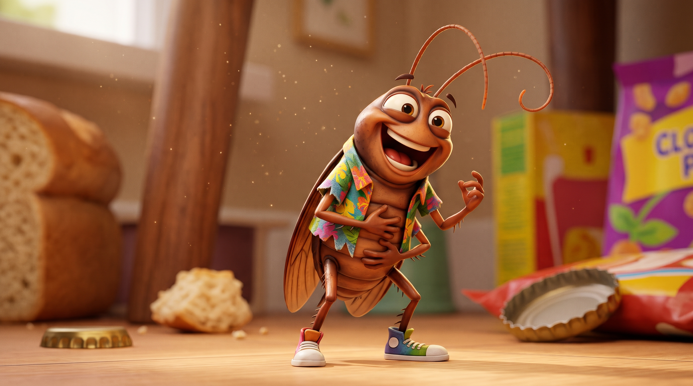
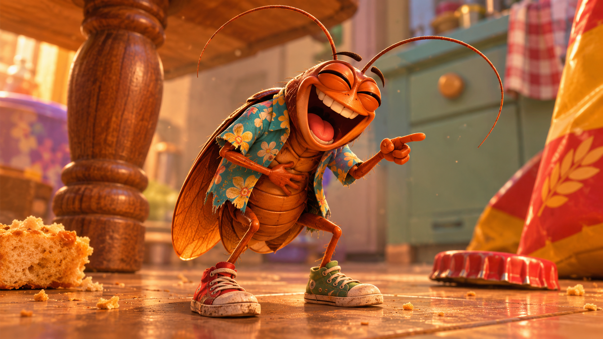
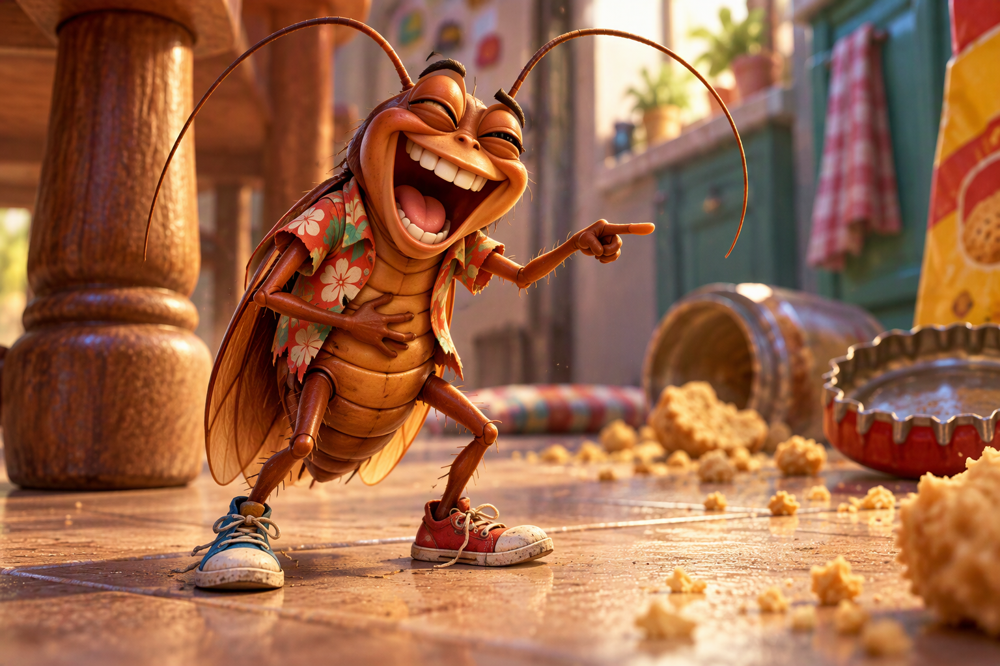

# Görsel Üretimi — Karşılaştırma

> **Görev prompt:** [prompt.md](./prompt.md)

## Skor Tablosu

| Kriter | Gemini | ChatGPT | Microsoft Copilot |
|--------|:------:|:-------:|:-----------------:|
| Promota Sadakat | 9/10 | 10/10 | 9/10 |
| Yazı ve Yüzler | 9/10 | 10/10 | 10/10 |
| Tutarlılık | 8/10 | 10/10 | 9/10 |
| Maliyet | 10/10 | 10/10 | 9/10 |

**Kazanan:** ChatGPT (tüm kriterlerde 10/10)

---

## Üretilen Görseller

### Gemini (Imagen 3)

### ChatGPT (OpenAI)

### Microsoft Copilot

---

## Değerlendirme

- **Genel kazanan:** ChatGPT — tüm kriterlerde 10/10
- **Yazı ve Yüzler:** ChatGPT ve Copilot eşit (10/10)
- **En düşük Tutarlılık:** Gemini (8/10)
